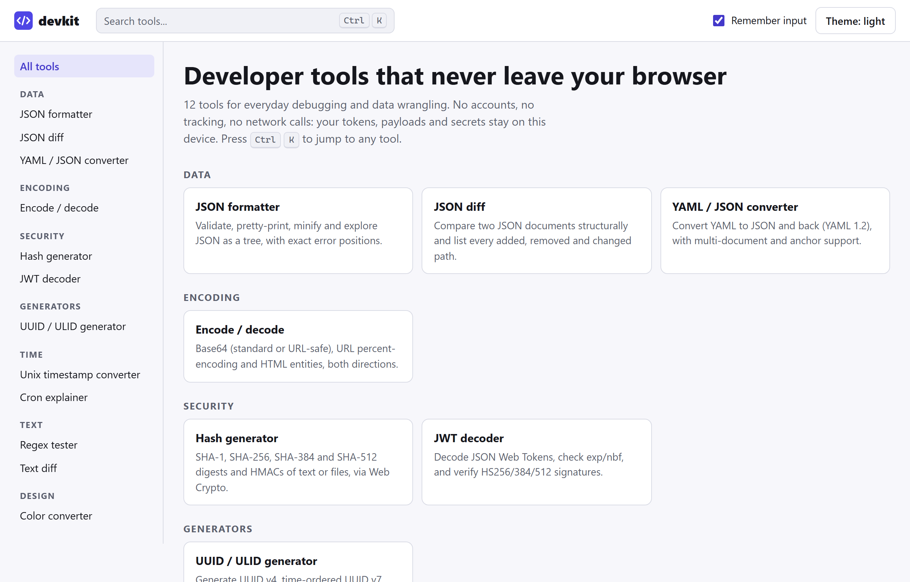
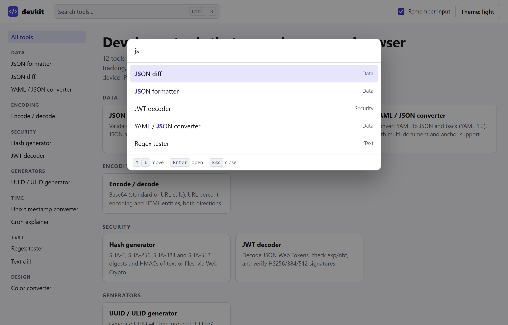
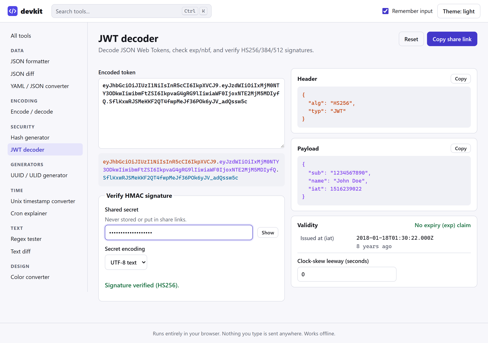
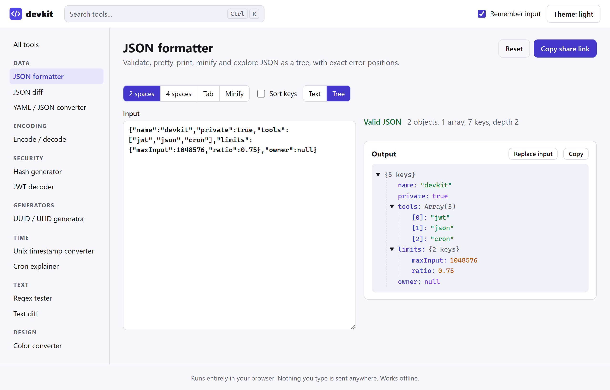
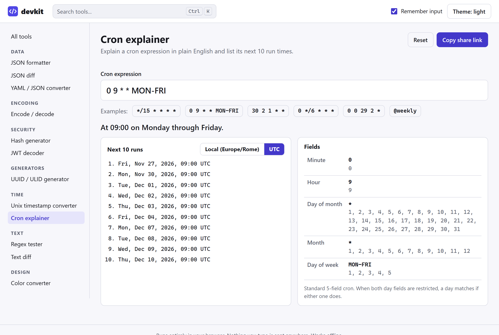
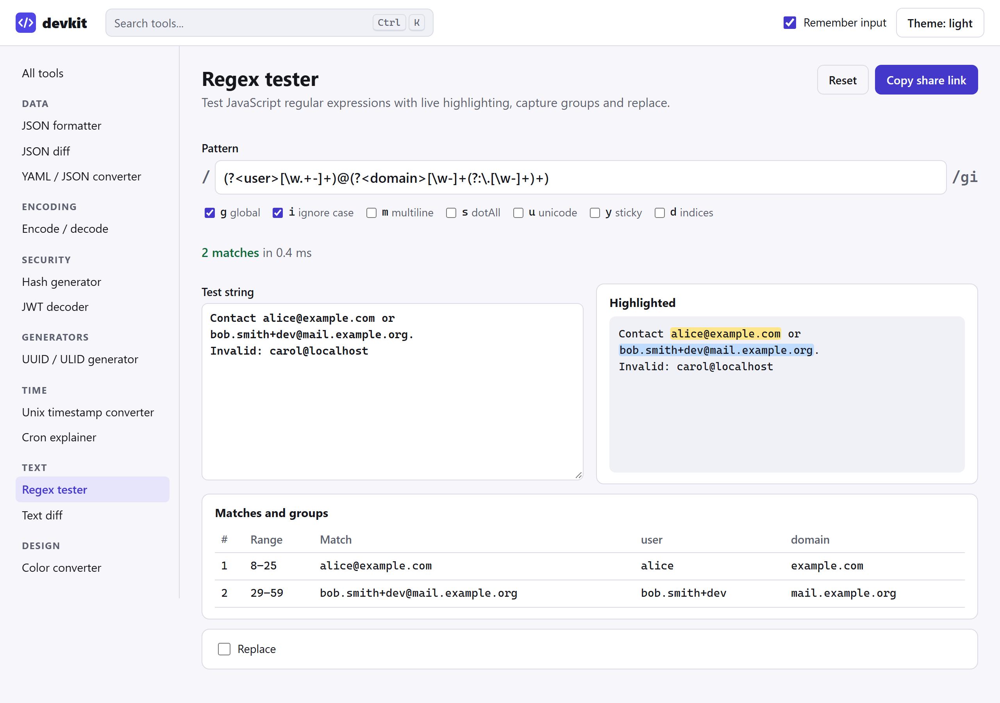
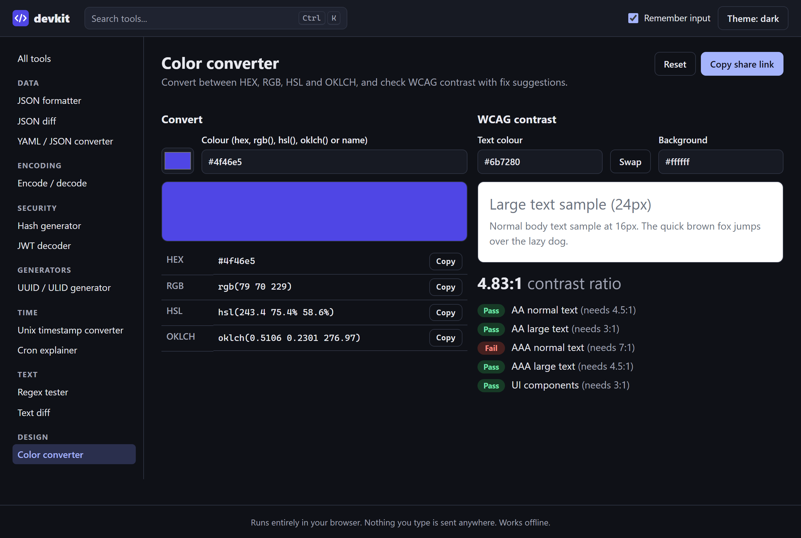
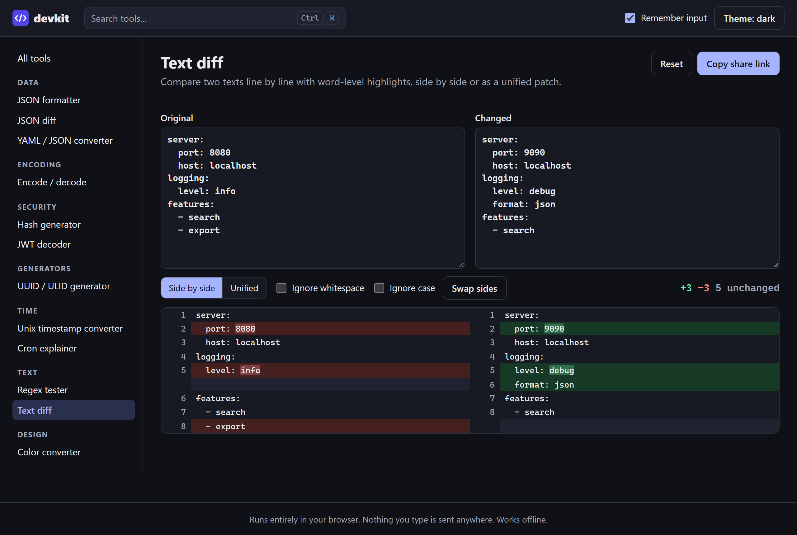
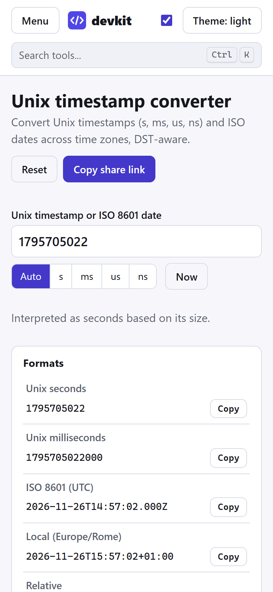

# devkit

A fast, privacy-first toolbox for developers. Twelve everyday tools (JWT, JSON, YAML, cron, regex, hashes, UUIDs, timestamps, colours, diffs and more) in one installable web app. **Everything runs locally in your browser; nothing you paste is ever sent to a server.**

[](https://github.com/Shgabnaz1377/devkit/actions/workflows/ci.yml)
  



## Why

Pasting a production JWT, an API response or a customer payload into a random website to "just decode it" is a habit worth breaking. devkit gives you the same convenience with none of the risk:

- **No network calls.** Tools are plain TypeScript running in your tab. Cryptography uses the browser's Web Crypto API.
- **No accounts, analytics or cookies.**
- **Works offline.** It is an installable PWA, and after the first visit every tool is cached by a service worker.
- **Secrets stay put.** Fields like the JWT secret and the HMAC key are never written to localStorage or into share links.

## Tools

| Tool | What it does |
| --- | --- |
| **JWT decoder** | Decode header/payload, check `exp`/`nbf`/`iat` with clock-skew leeway, verify HS256/HS384/HS512 signatures (secret as UTF-8, Base64, Base64url or hex). |
| **JSON formatter** | Validate with exact line/column errors and hints (trailing commas, unquoted keys, comments...), pretty-print, minify, sort keys, collapsible tree view, warnings for integers above 2^53. |
| **JSON diff** | Structural diff: keys compared regardless of order, arrays by index, with JSONPath-style paths for every change. |
| **YAML / JSON converter** | Both directions, YAML 1.2 semantics, multi-document streams, anchors and aliases (alias bombs are capped), errors with positions. |
| **Encode / decode** | Base64 (standard or URL-safe, binary-safe), URL encoding (component, full URI, form), HTML entities. |
| **Hash generator** | SHA-1/256/384/512 digests and HMACs of text or local files, hex/HEX/Base64 output, checksum comparison. |
| **UUID / ULID generator** | Bulk UUID v4, time-ordered UUID v7 (monotonic within a millisecond) and ULID, plus an inspector that extracts version, variant and timestamp. |
| **Unix timestamp converter** | Seconds/ms/us/ns auto-detection, ISO 8601 parsing, any IANA time zone, and wall-clock to timestamp conversion that reports DST gaps and ambiguous times. |
| **Cron explainer** | Plain-English description and the next 10 run times (local or UTC) for standard 5-field cron, with Vixie day-of-month/day-of-week OR semantics. |
| **Regex tester** | Live highlighting, numbered and named groups, replace preview, flag toggles. Matching runs in a Web Worker, so catastrophic backtracking is stopped instead of freezing the tab. |
| **Text diff** | Myers line diff with word-level highlights, side by side or as a `git`-style unified patch, with ignore-whitespace and ignore-case options. |
| **Color converter** | HEX/RGB/HSL/OKLCH conversion, WCAG 2.x contrast ratio with AA/AAA checks, and a suggestion for the nearest passing text colour. |

Every tool has its own URL (`#/jwt`, `#/cron`, ...) and a **Copy share link** button that encodes the current input into the link. It remembers your last input in localStorage unless you untick **Remember input**; turning that off also deletes what was stored.

### Command palette

Press <kbd>Ctrl</kbd>/<kbd>Cmd</kbd>+<kbd>K</kbd> anywhere to fuzzy-search tools (by name or alias, e.g. "epoch" or "sha256") and actions such as switching theme.



### Screenshots

| | |
| --- | --- |
|  |  |
|  |  |
|  |  |

<p align="center"></p>

All screenshots are captured from the real app by [`scripts/screenshots.mjs`](scripts/screenshots.mjs).

## Architecture

```
src/
  tools/
    registry.ts          # single source of truth: routes, sidebar, home grid and palette derive from it
    <tool>/<tool>.ts     # pure logic, no DOM, no Vue: easy to unit test
    <tool>/<tool>.test.ts
    <tool>/<Tool>View.vue
  composables/
    useToolState.ts      # per-tool state: share link > localStorage > defaults; private keys excluded
    useSettings.ts       # theme + "remember input", persisted
  components/            # CommandPalette, ToolLayout, CopyButton
  lib/                   # fuzzy matching, share-link codec, safe storage, clipboard
  pwa.ts                 # service-worker registration and offline-ready state
tests/e2e/               # Playwright specs
scripts/                 # icon and screenshot generators
```

Design decisions:

- **Pure core, thin views.** Each tool's logic is a framework-free module with focused tests; the Vue component only wires inputs to it. Error messages are part of the logic and are asserted in tests.
- **No heavy dependencies.** Runtime dependencies are `vue`, `vue-router` and `yaml`, plus Workbox for the service worker. The JWT verifier, cron scheduler, Myers diff, OKLCH maths, UUID v7/ULID generators and the strict JSON error locator are all written here.
- **Hash routing and a relative base.** The build is a folder of static files that works from any host or sub-path without rewrite rules.
- **Lazy-loaded tools, fully precached.** Each tool is its own chunk, and Workbox precaches all of them so tools you have never opened still work offline.
- **Untrusted input stays inert.** Share-link state is decoded defensively and merged only into known keys with matching types. HTML decoding is done with a pure function rather than `innerHTML`, and regexes run in a worker with a timeout.

## Local development

Requires Node.js 20.19+ (CI uses Node 24).

```bash
npm install
npm run dev          # Vite dev server
npm run lint         # ESLint (flat config, Vue + TypeScript)
npm run typecheck    # vue-tsc
npm test             # Vitest unit tests
npm run build        # type-check + production build into dist/
npm run preview      # serve dist/ locally
```

End-to-end tests run against the production build:

```bash
npm run build
npx playwright install chromium   # first time only
npm run test:e2e                  # starts `vite preview` automatically
E2E_BASE_URL=http://localhost:4317/ npm run test:e2e   # or target a server that is already running
```

Regenerating assets:

```bash
npm run icons                         # PWA icons from public/favicon.svg
node scripts/screenshots.mjs <url>    # README screenshots from a running build
```

## Testing

- **337 unit tests** (Vitest) across 13 files cover every tool's core logic, including published test vectors: RFC 4648 Base64, FIPS 180 SHA, RFC 4231 HMAC, the RFC 9562 UUID examples, the ULID spec, Ottosson's OKLab reference values, and well-known WCAG contrast pairs. Edge cases include malformed JWTs, JWE tokens and `alg: none`; invalid and never-firing cron expressions and leap days; UUID v7 ordering within a single millisecond and across a clock that goes backwards; DST gaps and overlaps; alias bombs; and a randomised Myers diff checked against an LCS oracle.
- **14 Playwright tests** cover the command palette (keyboard and mouse), opening every tool without console errors, share links (including that secrets are left out), the remember-input toggle, offline reloads through the service worker, and a 375 px layout without horizontal scrolling.
- CI (GitHub Actions) runs lint, type-check, unit tests and the build on every push and PR, then runs the Playwright suite against the built artifact.

## Deployment

`npm run build` produces a static `dist/` folder, so any static host works. It has not been deployed yet.

## License

[MIT](LICENSE) © 2026 Shabnaz Ghaffari
